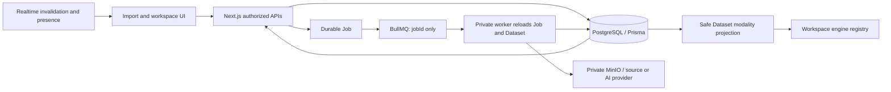

# Dataset modality workspace transition — feasibility and test plan

Date: 2026-10-06. Source checkpoint: `a5aa248`, branch `a2/s0-storage-authority`.

Status: planning and existing-test execution only. This document does not authorize application changes, shared-dev migrations, historical assignments, provider inference, image builds, deployment, or service restarts. Existing Phase 029 and Phase 026 task/gate states are preserved.

## Assessment

The transition is feasible with the existing Prisma, Next.js, private worker, MinIO and queue architecture. There is no need to replace Prisma or introduce another public backend. Candidate code already chooses the workspace engine from the authorized `Dataset.modality`; assets provide content and must match that modality.

Completing G-MIG and G-DEPLOY addresses application/schema compatibility. It does not automatically add fields to creation response DTOs, resolve every historical Dataset, prove provider capability, or finish bulk AI result persistence. Those are distinct acceptance conditions.

The preceding read-only diagnosis established that the currently configured shared database lacks the four M24 Dataset fields and M25 `PreparedImport.creationRequestHash`. The reported Dataset exists. Relevant reads return `P2022`, and deployed web logs contain the corresponding missing-column failures. This checkpoint does not repeat shared-data probes or change that database.

## Technical context and authority

- Existing TypeScript/Next.js/React web application; Prisma/PostgreSQL domain metadata and common durable Job; private worker; BullMQ transports only `{ jobId }`; MinIO holds binary objects.
- Reuse the existing four-entry workspace engine registry and versioned annotation/asset save barriers. No modality-specific routes, fallback engine, new Job model, or browser-side provider client.
- `Asset.modality` remains an integrity/content field. Engine choice is the persisted, authorized Dataset projection. Browser selection, URL keys, extension, MIME declaration, and legacy `primaryModality` cannot establish Dataset authority.
- The constitution file remains an unratified template. AGENTS.md and Phase 0 documents govern the boundaries. Phase 029 T003 records the required authority-document update; this planning checkpoint does not edit those files.
- No new package or environment variable is proposed. Migration/client artifacts remain frozen. Follow-on A2/M26 media verification is outside this checkpoint and must not enter the M24/M25 release package.

## Boundary ownership



The realtime gateway does not query Dataset records, choose an engine, publish assets, or execute AI. AI status currently uses authorized HTTP polling. Optional future invalidation events may prompt API refetch; PostgreSQL remains authoritative.

## Current versus proposed response contracts

All proposed additions are server-projected allowlists from committed/reused records, never an echo treated as authority. Existing IDs, HTTP status codes, response envelopes and idempotency behavior stay intact.

| Boundary | Current candidate contract | Proposed transition acceptance |
| --- | --- | --- |
| Generic `POST /api/datasets` | `201 data` is the Dataset projection and already includes `data.modality` | Retain existing envelope; assert persisted modality for all four choices |
| `GET/PATCH /api/datasets/{id}` | Metadata projection already includes `data.modality` | Retain field; PATCH cannot change modality |
| New `POST /api/imports/local-folder` | `201/202 data.preparation` contains dataset/job/item IDs; `200` on replay; no `data.dataset` | Add `data.dataset: { id, modality }` beside preparation, from the committed/reused parent; update DTO/schema consumers and contract tests |
| Local-folder append | Same preparation shape; parent selected by authorized route | Return the same safe parent projection; request still cannot choose/change its modality |
| `POST /api/datasets/from-repository` | `202 data.dataset: { id, name }`; replay `200` | Add `data.dataset.modality` from the persisted/reused Dataset; preserve Job/progress fields |
| `POST /api/source-import-preflight` | Read-only repository preview; validates optional chosen modality; no Dataset exists | Test validation/compatibility. Do not claim preview returns a persisted Dataset; any draft modality echo must be named as intent |
| `GET /api/datasets/{id}/workspace-state` | `200 data` includes id, name, modality, resolution state, canResolve | Already suitable; test authorization, null handling, and fresh reads |
| Unresolved workspace-state | `409 DATASET_MODALITY_UNRESOLVED`, safe projection in `error.details.dataset` | Preserve explicit unresolved state and no engine |
| `/workspace/{id}` | Server-rendered WorkspaceDataset props; registry dispatch from Dataset modality | Test deterministic empty shells, valid selection, flush-before-navigation, revision and lifecycle behavior |

Relevant existing files:

- `apps/web/src/lib/dataset-metadata.ts`: generic metadata projection.
- `apps/web/src/types/local-folder-preparation.ts` and `lib/imports/prepare-local-folder-import.ts`: preparation projection lacks parent modality in its public DTO.
- `apps/web/src/lib/repository-import/types.ts` and `acceptance.ts`: repository acceptance Dataset currently contains only id/name.
- `apps/web/src/lib/validation/source-connection.ts`: candidate and deployed source contain the preflight modality validation fix. Successful authenticated provider preflight is not established by the source-hash comparison or these tests.
- `apps/web/src/lib/datasets/modality.ts`, `lib/workspace/workspace-read.ts`, `components/workspace/workspace-engine.tsx`: authorized Dataset read and engine boundary already exist.
- `apps/worker/src/jobs/import-dataset.ts`: repository worker resolves Dataset modality and checks classified content.

## AI feasibility and separate prerequisites

Bulk selection plumbing already supports current asset, explicit IDs across pages, and filtered query intent. Next.js resolves authoritative assets, captures source identities, creates one Job/AiTask transaction, and enqueues only `{ jobId }`. Reuse this path.

Current runtime eligibility is narrower than four Dataset modalities:

| Dataset modality | Existing AI behavior | Acceptance scope for this transition |
| --- | --- | --- |
| IMAGE | Detection, verified maximum 3 assets; active locally registered compatible model must also exist in deployed catalog | Assess N=1..3; N=4 refuses. Full bulk result writes remain subject to Phase 026 HG-1 |
| VIDEO | Existing single-asset tracking path; batches refuse `AI_CAPABILITY_UNVERIFIED` | Preserve single-asset behavior only; no batch-support claim |
| AUDIO / TEXT | AI target resolver refuses unverified capability | Preserve clear unsupported state; an engine being available is not provider capability |

The platform bulk selection ceiling of 200 is not the provider-verified inference limit. Model discovery is read-only; registering a model is separate authorized work. No real provider inference, model registration, PAT operation or new provider package is performed in this checkpoint.

Concrete integration gaps identified by static audit:

1. `ai-target-service.ts` derives modality from selected Asset rows and exposes an asset-only transaction client. It does not read resolved Dataset modality. Plan a shared server check for Dataset visibility/resolution, selected Asset equality, supported task/model/modality, and existing source/workflow eligibility. Apply it to preview, acceptance, retry, dispatch and persistence rather than trusting the workspace UI.
2. Acceptance checks permission before external catalog/class reads, but does not repeat it inside the Serializable acceptance transaction. Recheck persisted requester authority, live Dataset, parent modality and target/source snapshot at commit; keep network I/O outside the transaction.
3. Dispatch verifies source digest and membership existence, but not the complete current Dataset/model/permission contract. Completion does not repeat accepted source identity or requester/Dataset eligibility. Design late-change refusal without overwriting newer/manual annotations or review-frozen content.
4. The current image completion writer writes flattened predictions and terminal success without the `perAsset` outcomes consumed by the batch status DTO. This is an existing success-accounting gap, not fixed by M24/M25. Plan exactly one outcome per accepted target, explicit zero-detection success, and reconciled counters.
5. Phase 026 `HG-1` remains OPEN for contractual deterministic result/input correlation. Its gated result attribution/write tasks must stay gated. Observed array order or returned path echo is not permission to guess correlation or implement the missing bulk writer.
6. Keep the existing public retry permission guard. An early successor return inside the helper should be reviewed for defense in depth, but the audited route already authorizes retry; no public bypass was established here.

## Ordered transition plan

| Step | Proposed work and owners | Exit evidence |
| --- | --- | --- |
| 1. Reconcile release baseline | Resolve T003 authority text in approved implementation; pin web/worker/client/schema/queue contracts and in-flight work policy | Reviewed Dataset authority, immutable release identities, no old writer left unaccounted for |
| 2. Make test coverage runnable at the current schema | Separately review fixed receipt-owned M24+M25 plans for workspace, AI and realtime; modernize stale fixtures without weakening gates | Exact test scopes, no root Prisma regeneration, positive disposable identity and independent cleanup |
| 3. Complete additive DTO contracts | Web safe types/projections, Zod response/request contracts where applicable, OpenAPI and browser consumers; use persisted parent on fresh creation and replay | Local-folder/repository responses expose correct Dataset modality, unchanged IDs/statuses, no metadata/credential leakage |
| 4. Prove engine transition | T025/T026/T027; reuse current registry and Dataset loader | Four empty shells; stale/foreign/wrong-modality selection refused; no query-selected engine; owner/admin EMPTY resolution races/audit; save barriers/revisions preserved |
| 5. Prove AI eligibility separately | Web/worker common Dataset checks, model capability, permission/source refresh; preserve verified limits and HG-1 | Invalid parents/selections/models cause no Job/provider call; valid IMAGE N<=3 accepted; unsupported modes refuse; all accepted outcomes reconcile once HG-1 is resolved |
| 6. Open the approved shared-dev window | Existing G-MIG/G-DATA/G-DEPLOY package: fresh inventory, drain, verified backup, M24/M25, approved historical assignments, compatible image cutover | Existing run-specific receipts and postflight; no automatic historical inference or unapproved assignments |
| 7. Browser/provider/RT acceptance | G5 browser/a11y; selected provider contract/source-access evidence; collaboration regression | Actual authenticated end-to-end import→workspace→eligible AI→safe persisted results. Label provider and RT coverage explicitly; do not infer them from unit passes |

Migrations alone leave historical Dataset modality NULL. Only approved verified assignments restore eligible historical engines; still-empty records use explicit owner/admin resolution, and mixed/incomplete records remain blocked under the accepted policy. Nothing automatically selects a modality for the reported historical Dataset.

Four-choice Dataset creation and empty-engine readiness do not imply four-modality local ingestion parity. Synchronous direct/local upload still refuses ambiguous VIDEO and Ogg content under the documented T022 limitation. Separate A2 verification work follows the M24/M25 rollout; it is not included or silently advanced by this plan.

Before G-DEPLOY, reconcile the release wording: T037 calls for coordinated web/worker/realtime rebuild, while the prepared execution package leaves realtime unchanged. Realtime needs no Dataset-modality authority code, but its approved image/contract compatibility and collaboration acceptance must be explicit rather than assuming either an unapproved rebuild or exemption.

## Test matrix and evidence limits

Tests run now use the existing fixed launchers and frozen bytes. No guard/catalog changes are made. Results are recorded below after each run completes; passing focused tests does not close G3, G5, G-MIG, G-DATA, G-DEPLOY or HG-1.

Future guarded scenarios required before acceptance:

- Four creation modalities; fresh/replay response equals persisted Dataset; missing/invalid input refused; conflicting key/modality/taxonomy is 409; atomic Dataset/Label/Job rollback.
- Preflight accepts chosen modality without creating domain rows; provider validation/URL/credential failure remains distinct from database readiness failure.
- IMAGE/VIDEO/AUDIO/TEXT empty engines, unresolved states, stale/foreign/wrong-modality Asset IDs, archived/deleted Dataset, revoked membership, current authority over stale client role.
- Original coordinates, canonical geometry and required annotation/asset revisions survive navigation and engine changes; completion routes to visualization and reopened datasets lose viewer eligibility.
- AI explicit/filtered/current selections, empty/foreign/mismatch/oversize targets, inactive or unregistered model, changed source before dispatch and after provider submission, review/access revocation during processing, duplicate delivery and retry/cancel races.
- Once HG-1 is resolved: same filenames, reordered/unknown/duplicate/missing result groups, explicit zero detections, invalid geometry, per-target outcome totals, preserved manual annotations and crash/replay-safe persistence.
- Existing realtime collaboration/ticket expiry/revocation regressions; optional AI invalidation must contain only safe event references and cause authorized API refetch.

Current runner limitations:

- Fixed `disposable-test.mjs` has no supported workspace/AI/preflight/realtime command, despite some catalog entries existing. An arbitrary direct test entry or a receipt for another suite is not permitted.
- Do not use legacy `g3-rehearse.py --g5 --runtime-e2e` for this checkpoint: it stages only M24 and invokes canonical generation that rewrites root `lib/generated/prisma`. That conflicts with the protected-file boundary and can miss M25 during import checks.
- Existing G5 runtime coverage does not start realtime or execute AI inference; historical G5 evidence is not a current provider/RT pass.
- Legacy AI tests include mixed-modality fixtures incompatible with Phase 029 invariants; test fixture review is required before claiming regression coverage.

## Results from this checkpoint

All selected suites passed. The total is **121 behavior/contract assertions plus 74 runner-safety assertions = 195 passing assertions**, with no skipped assertions in the reported suites. Counts include Node's named subtests where reported; repeated runner invocations are not counted twice.

| Suite | Result | Database scope / evidence |
| --- | --- | --- |
| Domain `dataset-modality.test.ts` | 8/8 | Pure source contracts; direct `node --import tsx` execution |
| Domain `ai-batch.test.ts` | 8/8 | Pure limits, source identity, outcomes, sanitization and retry contracts; no provider |
| Disposable runner safety | 74/74 | Existing offline launcher tests; receipt/chain/scope/cleanup contracts, no application target |
| `web:test:imports-ui:vitest` | 70/70 | 5 files; fixed runner stages historical 23 + M24; UI/schema coverage, not browser or persisted-response proof. Run `20261006T110723Z-c09e9643` |
| `web:test:local-folder-modality-idempotency` | 4/4 | Fresh disposable 25-migration chain; real Prisma preparation/replay/conflict checks. Run `20261006T110819Z-bad9b011` |
| `verify:confirmed-taxonomy-creation` | 27/27 | Fresh disposable 25-migration chain; generic, repository and folder service transactions, labels, replay, conflict and rollback. Provider preflight and browser are outside this suite. Run `20261006T110913Z-bb9ae318` |
| `worker:test:ingestion-replay-reuse` | 4/4 | Fresh disposable historical 23 + M24; repository reconciliation/reuse across four modalities. No live source-provider import. Run `20261006T111048Z-79d382b7` |

Each of the four disposable runs has `result: PASS`, no runner failures, primary cleanup `ok: true`, independent cleanup `result: PASS`, and independent cleanup exit 0. Their created containers, volumes, private credential stages and receipt registrations were removed. No shared application target/service was changed. Raw receipt/log artifacts remain under `verification/focused-runs/` and are git-ignored; these run identities are evidence references, not reusable authorization receipts.

These passes support current contract/service feasibility and isolate the earlier P2022 problem to the missing shared schema rather than the local-folder creation algorithm. They do **not** prove the proposed new creation response shape (not implemented), workspace browser hydration, realtime, live repository preflight, real AI provider execution, HG-1 correlation, or complete bulk success persistence.

Reproduction commands (existing packages and reviewed runner only):

```sh
# Run from packages/domain; these suites have no application/DB guard.
node --import tsx tests/dataset-modality.test.ts
node --import tsx tests/ai-batch.test.ts

# Run from repository root; disposable runs should remain sequential.
node scripts/db-safety/tests/disposable-test.test.mjs
node scripts/db-safety/disposable-test.mjs web:test:imports-ui:vitest
node scripts/db-safety/disposable-test.mjs web:test:local-folder-modality-idempotency
node scripts/db-safety/disposable-test.mjs verify:confirmed-taxonomy-creation
node scripts/db-safety/disposable-test.mjs worker:test:ingestion-replay-reuse
```

No new environment variables are needed for these fixed tests. They use fresh isolated child configuration. Do not supply shared `DATABASE_URL`, provider configuration or a receipt for another suite; no `.env` edit or root Prisma generation is a reproduction step.

## Completion boundary

Only this feasibility supplement and its link in the existing plan are intended tracked changes. No application/test-runner/Prisma/environment/architecture authority files or tasks are rewritten; no task is checked off by this report. The missing agent-context updater and absent extension hooks are tooling limits inherited from the earlier planning run; no substitute governance edits are made.

Next recommended checkpoint: review the additive response contract and the fixed M24+M25 workspace/AI test plans. Full implementation and shared-dev rollout remain separate authorized phases.

## Update 2026-10-06 (reconciliation with the A2/S0 checkpoint)

- **T003 is now closed (documentation only):** `docs/architecture.md`, `docs/job-system.md` and the one governing line in `AGENTS.md` state that `Dataset.modality` selects the engine; this supersedes the statement above that those files are not edited by this checkpoint (that statement described the report's own scope).
- **A catalog entry was added after the "no guard/catalog changes" statement:** `web:test:modality-workspace-feasibility` (full 25-migration chain, fixture-independent, one Dataset per modality) — run `20261006T115517Z-08c4ed01`, 3/3: per-Dataset modality projection, engine from `Dataset.modality` with no client override, IMAGE N=3 / single VIDEO AI target resolution and `AI_CAPABILITY_UNVERIFIED` for VIDEO batches, AUDIO and TEXT. See `release/modality-workspace-transition-feasibility.md`.
- **AI capability cells are evidence-labelled (`PROVEN` / `GATED` / `UNAVAILABLE`), not a frozen product policy** (owner decision, 2026-10-06). Verified today: IMAGE up to 3, VIDEO single; everything else is `GATED` until provider evidence exists.
- **T037 wording reconciled:** the cutover rebuilds web and worker; realtime stays unchanged per the execution package, with its compatibility acceptance stated explicitly.
- Open from this plan and unchanged: the additive response DTOs, Dataset-authoritative AI target and stale-test repair (approved, **after** the rollout), HG-1, G5 browser/RT acceptance.

### Clarification (2026-10-06): what the rollout does and does not deliver
G-MIG (M24/M25) delivers the database capability; G-DEPLOY delivers the *current* release application on it. The additive `modality` fields on the repository and local-folder creation responses, Dataset-authoritative AI targeting and the test repair belong to the separately approved post-rollout web change set and are **not** included in the current release images; they appear only after that change set ships.
